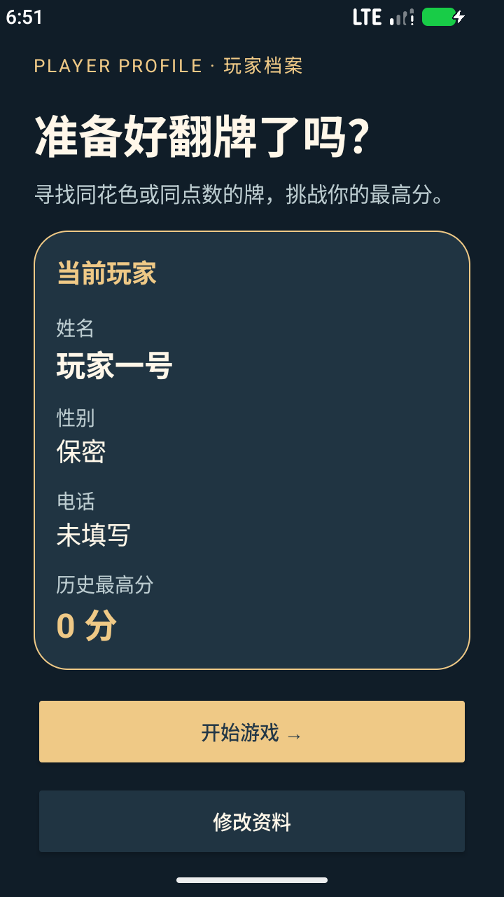
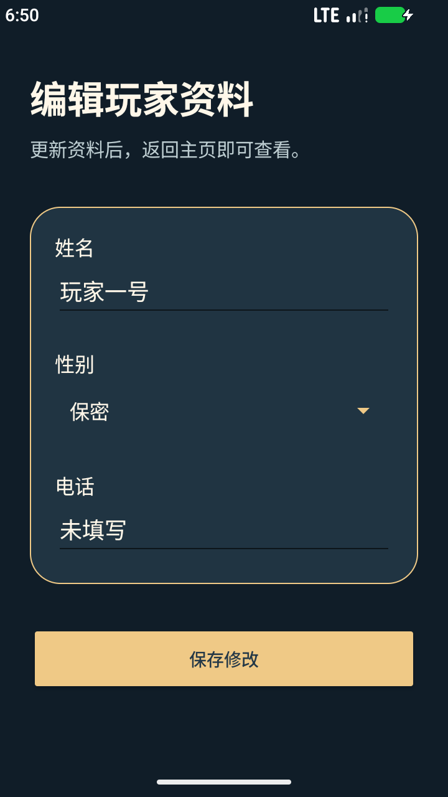
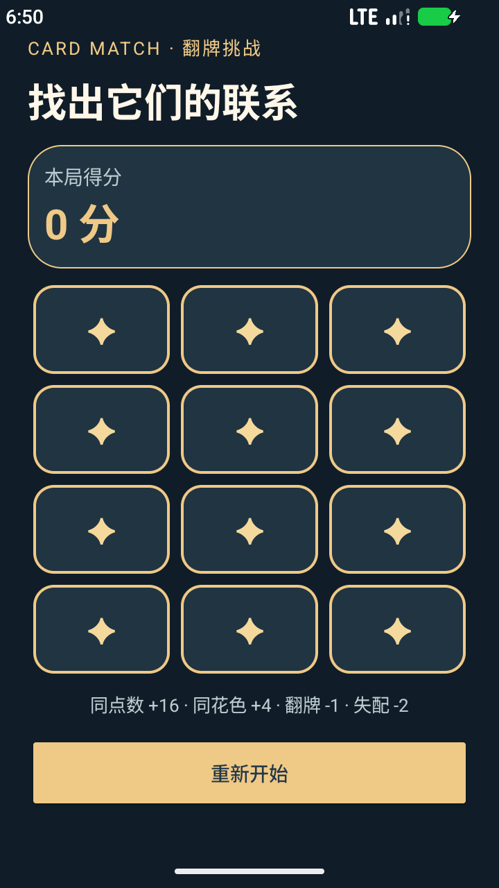
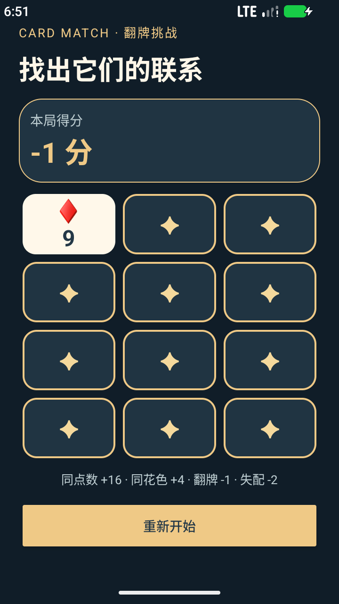

# 翻牌游戏实验报告

## 一、实验目的

1. 使用 Android 的 `ScrollView`、`LinearLayout`、`GridLayout`、`Spinner`、`EditText` 等布局及控件。
2. 通过 MVC 将游戏数据、交互控制和界面展示分开。

## 二、设计与实现

应用包含三个 Activity：主页 `MainActivity` 展示姓名、性别、电话和最高分；`EditProfileActivity` 修改玩家资料；`GameActivity` 展示 3 列 × 4 行的翻牌棋盘和重新开始按钮。资料与最高分保存在进程内的 `PlayerSession` 中，不写入文件，进程重启后恢复默认资料。

游戏模型为 `Card`、`Deck` 和 `CardMatchingGame`；布局文件、卡牌图形和字符串资源属于 View；`GameActivity` 根据点击事件调用模型并重绘视图，是 Controller。牌堆共有 52 张不重复的牌，开局随机抽取 12 张；相同点数匹配值为 4，相同花色为 1。匹配奖励为匹配值 × 4，每次翻牌扣 1 分，不匹配额外扣 2 分。没有可配对的剩余牌时，显示结束提示，可重新开局。

### 主要代码

配对规则（`Card.kt`）：

```kotlin
fun match(other: Card): Int = when {
    rank == other.rank -> 4
    suit == other.suit -> 1
    else -> 0
}
```

模型的计分与状态更新（`CardMatchingGame.kt`）：

```kotlin
if (matchScore > 0) {
    score += matchScore * 4
    other.isMatched = true
    card.isMatched = true
} else {
    score -= 2
    other.isChosen = false
}
score -= 1
card.isChosen = true
```

控制器处理翻牌并同步界面（`GameActivity.kt`）：

```kotlin
view.setOnClickListener {
    game.chooseCardAtIndex(index)
    val profile = PlayerSession.get(this)
    profile.highScore = maxOf(profile.highScore, game.score)
    render()
}
```

玩家资料在编辑页保存后更新到共享的内存会话，主页在 `onResume()` 中重新显示。所有界面文案、牌面符号和点数字符串都取自 `strings.xml`，布局与界面代码不直接硬编码显示文字。游戏状态在屏幕旋转时通过 `onSaveInstanceState` 保留。

## 三、运行界面

主页：



编辑资料：



游戏界面：



翻开一张牌后，牌面显示、分数减少 1 分：



## 四、测试与结果

| 类型 | 测试内容 | 预期结果 |
| --- | --- | --- |
| 单元测试 | 52 张牌不重复、牌堆耗尽 | 每张牌只出现一次，耗尽后返回空 |
| 单元测试 | 点数/花色匹配、失配、结束判断 | 分别计分 14、2、-4；无可配对牌时结束 |
| UI 测试 | 修改姓名、性别和电话并返回主页 | 主页展示修改后的资料 |
| UI 测试 | 翻开一张牌后重新开始 | 得分从 -1 恢复到 0，牌重新盖住 |

运行 `./gradlew :app:testDebugUnitTest :app:connectedDebugAndroidTest` 可重复执行测试。UI 测试需要已启动的 Android 模拟器或真机。

**实测结果：** 在 Android 模拟器上，5 项单元测试和 2 项 UI 测试均通过，Debug APK 构建成功。测试过程中发现原模板 Espresso 3.5.1 在当前模拟器上无法注入点击事件，更新到 3.7.0 后解决；按钮位于小屏幕下方时点击失败，通过收紧界面间距，并在测试中先滚动到按钮后解决。
